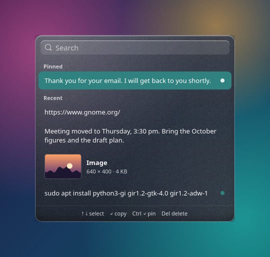
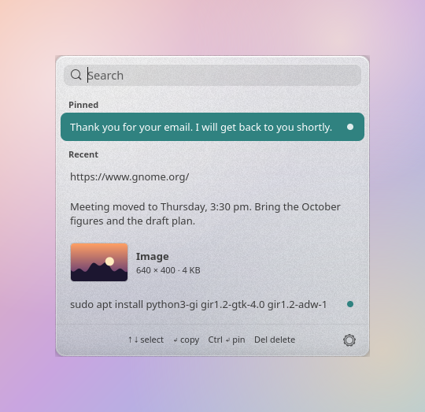
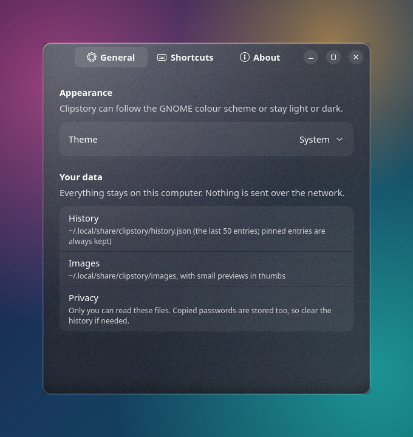
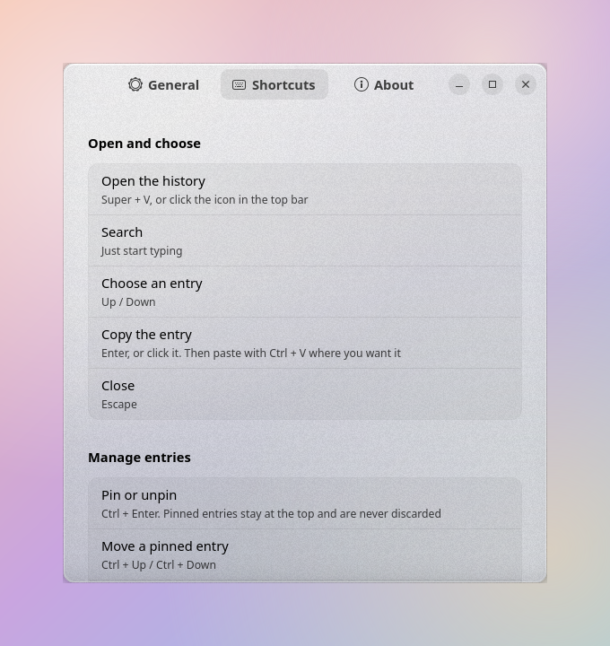

# Clipstory

Clipboard history for GNOME on Wayland. Press **Super + V**, search what you copied, pick it, paste it.

It remembers text and images, lets you pin the entries you reuse, and opens in a translucent
glass-style window that follows your GNOME colour scheme and accent colour.

<p align="center">
  
  
</p>

<sub>The screenshots show sample entries over a sample wallpaper, so that the transparency is visible.</sub>

## Features

- **Text and images.** Screenshots and copied images appear as small previews with their size.
- **Instant search.** Open the window and start typing.
- **Pinned entries.** Pin what you use often: it stays at the top and is never discarded.
- **Marks the current entry.** A coloured dot shows what is in your clipboard right now.
- **Keyboard first.** Everything works without the mouse; the shortcuts are listed below.
- **Local only.** History is stored in your home folder with private permissions. Nothing is sent anywhere.
- **Glass look.** A translucent panel with a highlight, a thin rim and a fine grain; light, dark or follow the system.

## Requirements

- GNOME Shell **45 to 50**. Developed and tested on GNOME Shell 50.1 (Ubuntu 26.04, Wayland).
  Older or newer versions are expected to work but have not been tested.
- Python 3 with the GTK 4, libadwaita and GdkPixbuf bindings:

  ```
  # Debian / Ubuntu
  sudo apt install python3-gi gir1.2-gtk-4.0 gir1.2-adw-1 gir1.2-gdkpixbuf-2.0
  # Fedora
  sudo dnf install python3-gobject gtk4 libadwaita
  # Arch
  sudo pacman -S python-gobject gtk4 libadwaita
  ```

## Install

One command, for your user only (no `sudo`):

```
curl -fsSL https://raw.githubusercontent.com/Sestiano/clipstory/main/install.sh | bash
```

Or from a clone:

```
git clone https://github.com/Sestiano/clipstory.git
cd clipstory
./install.sh
```

The installer checks the requirements, copies the extension to
`~/.local/share/gnome-shell/extensions/clipstory@seb.local`, enables it, and frees `Super + V`
from the GNOME notification list (the list stays on `Super + M`). To keep the notification
shortcut as it is, use `./install.sh --keep-super-v`.

**Then log out and back in.** On Wayland GNOME loads a new extension only when you log in.
After that, copy something and press `Super + V`. Run the installer again at any time to update.

## Using it

| Keys | What it does |
|---|---|
| `Super` + `V`, or click the top-bar icon | Open the history |
| *start typing* | Search |
| `↑` / `↓` | Choose an entry |
| `Enter`, or click | Copy the entry to the clipboard and close (then paste with `Ctrl` + `V`) |
| `Ctrl` + `Enter` | Pin or unpin the entry |
| `Ctrl` + `↑` / `Ctrl` + `↓` | Move a pinned entry |
| `Delete` | Delete the entry (only while the search field is empty) |
| `Esc` | Close |

Right-click the icon in the top bar to open the settings. They have the same glass style and also
include this table and an explanation of the dots:

<p align="center">
  
  
</p>


- **Grey dot**: the entry is pinned.
- **Coloured dot** (your accent colour): this entry is what is in the clipboard right now. On the
  selected row it is drawn as a ring.

Entries are grouped under **Pinned** and **Recent**. The history keeps the last 50 entries.

## Your data and privacy

Everything is kept in `~/.local/share/clipstory`, readable only by you:

| Path | Content |
|---|---|
| `history.json` | The entries (text and image names, pin state) |
| `images/` | Copied images, as PNG |
| `thumbs/` | Small previews, rebuilt when missing |
| `current` | A hash that identifies the entry now in the clipboard |
| `settings.json` | Your theme choice |
| `grain.png`, `grain-light.png` | The noise tiles used by the glass look |

Clipstory never uses the network. It does store whatever you copy, **including passwords copied
from a password manager**. Delete an entry with `Delete`, or remove `history.json` and `images/` to
clear everything. Images over 20 MB are ignored.

## How it works

A small GNOME Shell extension watches the clipboard and writes new entries to `history.json`.
The window opened by `Super + V` is a separate GTK 4 / libadwaita program (`main.py`) that reads
that file. The details, including why it is built this way, are in
[docs/how-it-works.md](docs/how-it-works.md).

## Limitations

- **No automatic paste.** Choosing an entry puts it in the clipboard; you press `Ctrl` + `V`.
  Wayland does not let one program type into another.
- **No real blur.** GNOME does not offer applications a blurred background, so the glass is
  simulated with transparency, gradients, highlights and grain.
- Password manager entries are not recognised and are stored like any other text.

## Troubleshooting

- **Nothing happens on `Super + V`, and there is no icon in the top bar.** Log out and back in
  after installing. Then check the extension: `gnome-extensions info clipstory@seb.local`. The state
  should be `ACTIVE`. If it shows `ERROR`, look at the log: `journalctl --user -b -o cat | grep -i clipstory`.
- **`Super + V` still opens the notification list.** Another shortcut is using it. Check
  `gsettings get org.gnome.shell.keybindings toggle-message-tray`; it should be `['<Super>m']`.
  Running `./install.sh` again fixes it.
- **The window appears but does not react to the keyboard.** This can happen if your pointer is
  not over it and your GNOME is set to focus follows mouse. The extension activates the window
  when it opens; make sure you logged out and in after the last update.
- **The Python error `No module named 'gi'` or a missing GTK / Adw version.** Install the packages
  listed under Requirements.

## Uninstall

```
./install.sh --uninstall           # remove the extension, restore Super + V
./install.sh --uninstall --purge   # also delete your history and images
```

Then log out and back in.

## Contributing

Issues and pull requests are welcome. The guidelines are short: keep the code simple and
idiomatic, write code, comments, logs and UI text in English, and use no emojis.

By submitting a contribution you agree that it is licensed under the same terms as the project
(GPL-3.0-or-later). Please do not submit code you do not have the right to share, or code copied
from a source with an incompatible licence.

## Licence

Copyright (C) 2026 Sebastiano Franchini.

Clipstory is free software, released under the **GNU General Public License, version 3 or, at your
option, any later version** (GPL-3.0-or-later). The full text is in [LICENSE](LICENSE).

In short:

- You may use, study, share and modify it, also at work and also commercially.
- If you distribute a modified version, or include it in something you distribute or sell, you must
  release your complete source under the same licence, keep the copyright notices and mark your
  changes. Nobody can take this code, close it and sell it as proprietary software.
- It is provided **without any warranty**, and the author is **not liable** for any damage that comes
  from using it (sections 15 and 16 of the licence). Note in particular that it stores what you copy,
  passwords included, on your computer; see "Your data and privacy".

Clipstory uses GTK 4, libadwaita and PyGObject (LGPL-2.1-or-later) and runs inside GNOME Shell
(GPL-2.0-or-later). None of their code is included in this repository.
